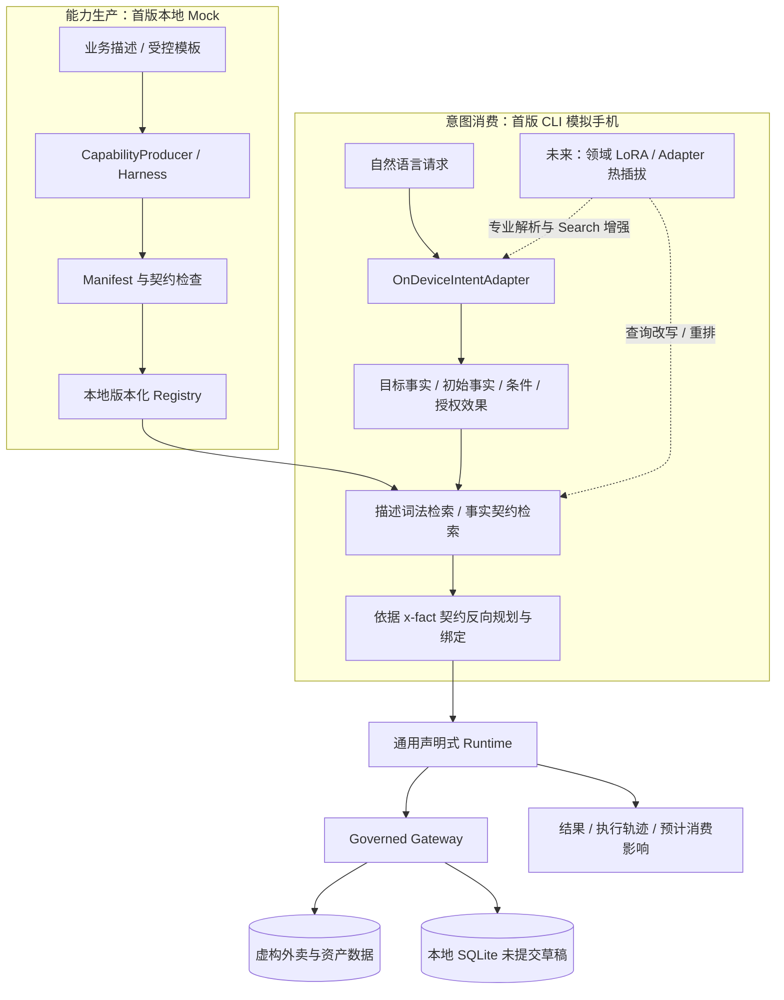
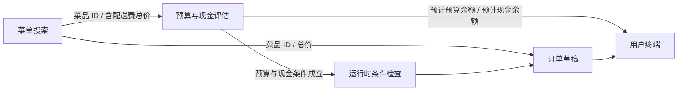

# Splice 架构与执行边界

Splice（Composable Service Access for Agents，面向 Agent 的组合式服务访问）的目标是：Agent 按意图组合访问底层服务，无需预制中间业务 Service。省去的是为具体业务流程人工编写的中间层，底层服务与 Gateway 仍负责资源和执行约束。

Splice 研究从能力生产到意图消费的生命周期：服务侧生产版本化能力，Registry 分发可检索契约，设备把需求表达为目标与约束，Runtime 通过通用原语执行插件，Gateway 保护资源与状态。思想与经济假说见 [THESIS](docs/THESIS.md)；本文说明首版技术边界。

首版是本地 Python CLI 原型，使用单用户 `demo-user` 与固定的 `2026-10` 默认数据快照，“本月”不跟随系统时钟。Cloud Harness 与手机端模型分别由明确标注的 Mock 接口模拟；Runtime 对本地虚构资源的操作模拟服务访问与组合，尚未连接真实远程底层服务，也没有云端部署、真机推理、模型训练、真实订单或真实资产操作。

## 四个职责，而非四个部署服务

模块分开表达责任，不要求微服务或网络边界。Mock 生产者从受控示例产生 Manifest；未来真实 LLM 生产者仍须经过同一个发布检查流程，不能将生成文本直接提升为执行权限。端侧 Adapter 的替换也不改变 Gateway 的判断权。

## 协议如何连接目标与能力

### 意图先表达事实需求

结构化意图包含希望得到的 `requested_outputs`、用户提供的初始 `facts`、执行条件 `gates` 和允许的 `authorized_effects`。它描述“要知道什么、满足什么、允许做什么”，不在 CLI 中指定“先调用 A 再调用 B”。

例如跨域目标需要草稿、计划消费后的餐饮预算与现金余额；初始事实包含餐品类型、总价上限和月份；条件要求预算与现金允许。能力发现和调度依赖 Registry 内真实存在的契约。Mock 解析器只支持三个演示句式族及不生成草稿的外卖搜索变体，可作有限金额、月份与清淡偏好的替换；不认识的复杂约束会拒绝，不构成开放域中文理解能力。

### Manifest 声明版本、契约与执行计划

每个插件提供身份与版本、能力语义、示例、输入输出 JSON Schema、权限、资源、前置条件、效果以及受限执行计划。Schema 属性中的 `x-fact` 标注语义事实，使 Planner 能把某插件的输出绑定到另一插件的输入。

`x-fact` 是本项目的协议约定，不是 JSON Schema 标准自带的语义推理能力。Schema 检查数据形状；事实标识连接含义。二者都依赖发布者正确描述单位、作用域与语义，不能单凭同名字段推断“资产总额”和“可支付现金”相等。

Manifest 是数据声明，不接受任意 Python、JavaScript 或 SQL。插件文件也不会自行获得权限：它只能请求资源和动作，由 Gateway 独立判断是否允许。

### Planner 根据目标反向查找生产者

Registry 提供两个可观察的检索入口：描述搜索按英文词和中文双字词重叠排序，返回匹配词与分数；Planner 则按输出属性的 `x-fact` 精确查找提供者。前者方便检查描述可发现性，后者决定当前执行依赖；首版没有让词法相关度决定业务可执行性，也没有实现向量语义检索。

Planner 从目标事实和条件所需事实开始，寻找输出对应事实的插件，再递归寻找该插件输入所需事实，形成有限的依赖计划。绑定时检查实际参数与输入 Schema，插件输出也须通过输出 Schema。每个插件 ID 默认使用最高的数字版本；缺少提供者、不同 ID 提供者重复或事实依赖成环时拒绝规划。

这一机制是受限的声明式依赖解析。它不是任意任务分解、开放世界推理或完整工作流语言。一个计划中每个插件版本最多调度一次；只读步骤不能依赖待执行写入，条件也不能依赖写入结果。能力重叠的择优、版本兼容、条件分支、长事务与补偿都是后续研究重点。

## 从只读计算到草稿写入

一次跨域请求形成以下数据关系。箭头表示事实依赖，不是 Adapter 中的专用函数调用表。

1. Runtime 执行计划中的只读步骤，菜单插件计算菜价与配送费合计，金融插件在其独立权限内评估拟消费。
2. 条件检查要求授权数据足以作出判断。缺少金融权限时不得把未知预算当作预算充足；预算不足时不得持久化草稿。
   条件事实必须由 Registry 中的能力产出；Adapter 不能将 `budget.within_limits=true` 塞入初始事实来跳过评估。
3. 写入还必须满足意图允许的效果、用户授权与 Gateway 资源策略。意图中的一句“可以写入”不等于拥有对应权限。
4. 本地草稿在事务内写入，输出契约验证成功后才提交；失败应回滚。草稿保持 `status=draft`。
5. 结果展示草稿与预计消费影响。预算评估没有扣减现金、创建支付流水或卖出持仓。

首版确认指向生成本地草稿。请求已明确说“生成订单草稿”时，Mock 将 `draft.create` 纳入 `authorized_effects`，无需重复确认；CLI 的 `--confirm` 也可显式授权本次草稿效果。两种方式都不能越过 Gateway 的写权限。`run` 默认只有 `food` 权限配置；跨域请求需显式选择 `--profile combined`，资产概览需 `--profile assets`。三个 `demo` 子场景则自动采用各自的演示授权配置。

预算条件属于整条意图的 `gates`，由 `Runtime.run` 检查。底层 `Runtime.invoke` 用于单插件契约实验，不会自动补出一个跨域预算计划；Gateway 自身也不会因为写草稿就猜测用户是否要求检查预算。场景 A 因而可以只用外卖权限，场景 C 则必须具备其金融条件需要的权限。

## Runtime 原语与 Gateway 的区别

Runtime 解释 `read / filter / project / aggregate / compare / sort / assert / insert` 通用操作及受限表达式，资源关联使用 `lookup` 表达式。菜单价格筛选、现金汇总和预算比较由数据与声明表达，不新增按插件 ID 分派的业务 Handler。

表达式支持 `add / sub / mul / min / max` 算术，`eq / ne / lt / lte / gt / gte` 比较，`and / or / not / contains` 判断，以及 `sum / count / first / lookup` 数据操作。`lookup` 要求恰好一个匹配，`$input`、`$row` 和步骤变量提供受限数据引用；不存在源码 `eval` 或表达式直接 I/O。

Gateway 掌握可信资源目录、权限规则和写入不变量。授权必须同时满足用户授予、插件声明与资源策略，不能让 Manifest 自报一个金融权限就读取金融明细。外卖资源和金融资源具有独立访问边界；插件声明的领域身份也不构成对任意第三方包的来源认证。

本地草稿的可信资源约束包括只允许草稿状态、从可信菜单与配送数据核对价格、检查价格上限等。此处仍然存在预置的数据语义与状态规则。实验的主张是复用受控执行边界，而非消灭所有领域知识。评估扩展成本时，必须同时计入新增资源规则、原语和契约维护。

| 责任 | 适合放置的位置 | 边界 |
| --- | --- | --- |
| 菜价加配送费、筛选候选、按字段汇总 | Manifest 与通用表达式 | 不获得额外权限 |
| 解释依赖、绑定输入输出、执行受限操作 | Planner / Runtime | 不相信模型生成的授权判断 |
| 用户授权、资源可见性、可写状态与可信价格 | Gateway / 资源契约 | 不承载整条跨域专用工作流 |
| 真实支付、供应商订单承诺、外部补偿 | 后续确定性服务或适配器 | 首版没有实现 |

## 数据与金融信息隔离

外卖虚构资源包含商家、菜单、配送费和订单草稿；金融虚构资源包含现金账户、投资持仓、固定估值快照、消费流水和月度预算。它们共同支持跨域目标，但不共享全部明细。

预算插件可读取经授权的预算、现金与支出，在本插件内部计算，只导出执行所需的限额、判断与预计余额。食品插件的参数只需菜品、总价和上限等事实；不接收账户、持仓或原始流水。资产概览在用户主动请求并拥有金融权限时，独立向终端展示现金、投资估值和总资产。

现金、投资估值和预算是不同事实。固定快照不等于可交易报价；持仓不等于现金；草稿也不占用预算。两次草稿的预测可能使用同一份未变预算，因此本原型没有证明并发预算预占能力。

执行轨迹用于观察候选、Schema 绑定、授权判断和结果，使用虚构数据。真实系统还需要日志脱敏与保留策略；首版不应被描述为已经具备生产级金融隐私保护。

## 当前原型与未来增强

| 当前实验 | 后续研究 |
| --- | --- |
| 本地文件 Registry、数字版本、词法描述搜索与事实契约检索 | 来源认证、撤销、兼容性、多源发现与检索评测 |
| MockCapabilityProducer 与有限请求适配器 | 可选 LLM 生产、真实端侧小模型 |
| 受限声明式依赖与通用操作 | 复杂组合、重规划、缓存与自动编译 |
| 单用户虚构资源、SQLite 本地草稿 | 多租户隔离、预算预占、真实业务授权 |
| 领域 LoRA 不参与运行 | 热插拔提升意图解析、Query Rewrite、召回、重排与专业知识检索 |

领域 LoRA 的加载与分发只增强语义侧，不能替代 Registry、Schema、Gateway 或真实执行确认。具体研究路线见 [Roadmap](docs/roadmap.md)，未解决的问题见 [open-questions](docs/open-questions.md)。
